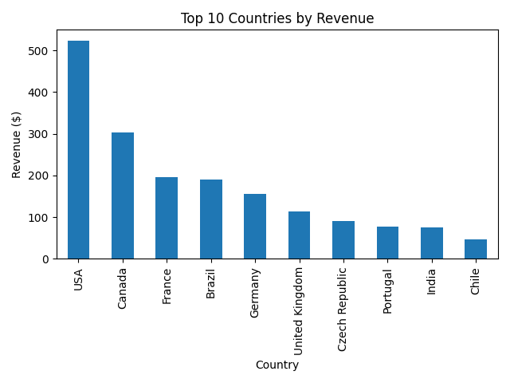
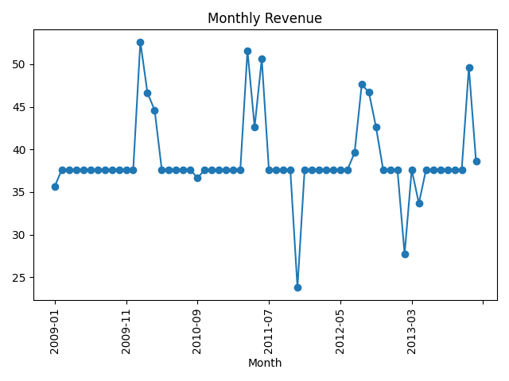

# SQL-Based Analysis of Product Sales (Chinook)

**Goal:** Use SQL to find out what sells best, where the revenue comes from, and how sales change month by month.
## Dataset
[Chinook Database](https://www.kaggle.com/datasets/ranasabrii/chinook/data) is a sample database of a digital music store. It has tables for tracks, albums, artists, genres, customers, invoices and invoice lines. Sales data covers 2009 to 2013.

## Tools Used
- SQLite (queried with DB Browser for SQLite)
- Python (sqlite3, pandas, matplotlib)
- Jupyter Notebook in VS Code

## Business Questions
1. Which products (tracks) sell the most?
2. Which countries bring the most revenue?
3. How does revenue change month by month?
4. Which genres and customers matter most?

## SQL Skills Used
JOINs (up to 4 tables), GROUP BY and aggregations, CTEs, and window functions (`RANK()` and `LAG()`).

## Project Files
- `queries.sql`: all 10 SQL queries with comments
- `analysis.ipynb`: Python analysis and charts
- `Chinook_Sqlite.sqlite`: the database
- `images/`: screenshots and charts

## Key Insights

**Total revenue analyzed: $2,328.60** (verified: country totals match the invoice total)

1. **The USA is the strongest market.** It generated $523.06 from 91 orders, about 22% of total revenue. Canada is second ($303.96) and France third ($195.10). The top 3 countries together bring in about 44% of all revenue.

2. **Rock is the top-selling genre by a wide margin.** Rock earned $826.65, about 35% of revenue and more than double Latin ($382.14). Rock, Latin, Metal ($261.36) and Alternative & Punk ($241.56) together make up about 73% of revenue.

3. **Monthly revenue is stable, with a few spikes and dips.** Most months earn about $37.62 from 7 orders.
   - Strongest months: 2010-01 ($52.62), 2011-04 ($51.62), 2011-06 ($50.62).
   - Weakest months: 2011-11 ($23.76), 2013-02 ($27.72), 2013-04 ($33.66).
   - The weakest month (2011-11) was about 37% below a typical month.

4. **Customer spending is evenly spread.** The top customer overall is Helena Holý (Czech Republic) with $49.62, only about 2% of total revenue.Top spenders in each country are close together (for example Astrid Gruber in Austria spent $42.62, François Tremblay in Canada $39.62, Luís Gonçalves in Brazil $39.62). No single customer drives the business, so the risk of depending on one big customer is low.

5. **There is no single "hit" product.** Eight tracks are tied at $3.98 (2 units each), so sales are spread across the catalog instead of a few blockbusters.

### Recommendations
- Focus marketing on the **USA, Canada and France**, which bring in about 44% of revenue.
- Promote **Rock and Latin** content, since these genres drive the most sales.
- Run promotions before and during weak periods (like late 2011 and early 2013) to smooth out the dips.
- Offer loyalty rewards to the top customers in each country.

## Results

### Top 10 Countries by Revenue

### Monthly Revenue

## How to Run
1. Clone this repository.
2. Open `queries.sql` in DB Browser for SQLite with `Chinook_Sqlite.sqlite` and run each query.
3. Install the libraries: `pip install pandas matplotlib jupyter`
4. Open `analysis.ipynb` and click Run All.
